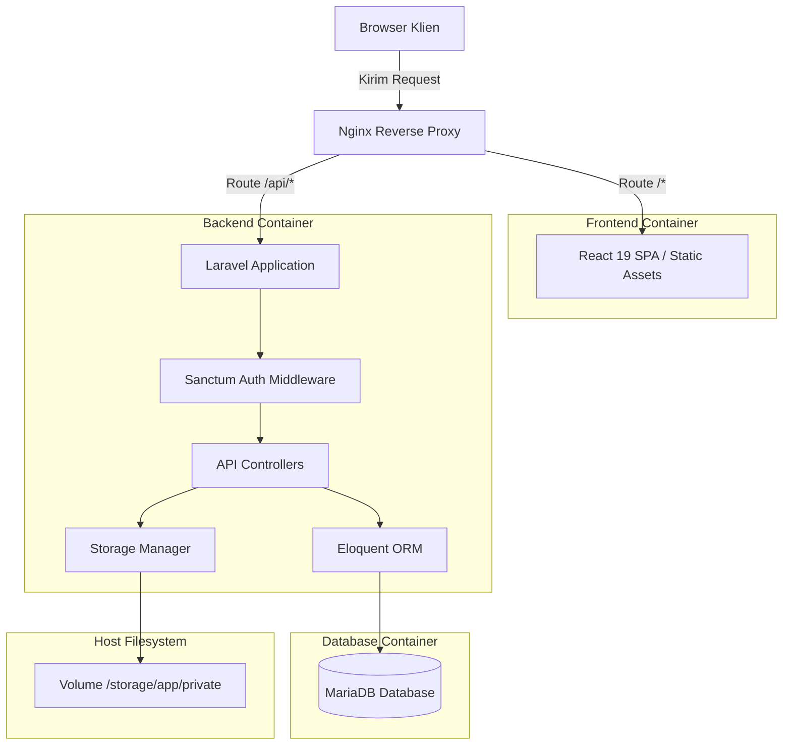

# Architecture

Dokumen arsitektur sistem Trackripsi.app. Desain sistem modular, terpisah antara frontend SPA dan backend RESTful API.

## System context

Sistem berjalan independen tanpa integrasi eksternal (SIAKAD, Google OAuth, atau WhatsApp Gateway). Fokus sistem: produktivitas personal mahasiswa tingkat akhir untuk mengelola linimasa, draf naskah, log bimbingan, dan tugas skripsi mandiri. Satu pengguna dapat mengelola lebih dari satu proyek riset.

```
+-------------------------------------------------------------+
|                     Mahasiswa (Pengguna)                    |
+-------------------------------------------------------------+
                              |
                     HTTP / HTTPS (JSON)
                              v
+-------------------------------------------------------------+
|                   Trackripsi.app System                    |
|                                                             |
|  +--------------------+             +--------------------+  |
|  |     Frontend       |   REST API  |      Backend       |  |
|  |  React 19 SPA      | ----------> |    Laravel 12      |  |
|  |  (Tailwind CSS v4) |             |  (Sanctum + ORM)   |  |
|  +--------------------+             +--------------------+  |
|                                              |              |
|                                     +--------+--------+     |
|                                     |                 |     |
|                                     v                 v     |
|                              +-------------+   +---------+  |
|                              |   MariaDB   |   | Disk /  |  |
|                              |  Database   |   | Storage |  |
|                              +-------------+   +---------+  |
+-------------------------------------------------------------+
```

| Aktor / Komponen | Peran |
| :--- | :--- |
| **Mahasiswa** | Aktor tunggal. Input target, update status bab, unggah draf berkas, catat log mandiri. |
| **React SPA** | Antarmuka pengguna berbasis browser. Render UI, state management, komunikasi HTTP client via Fetch / Axios. |
| **Laravel API** | Penyedia data RESTful. Validasi request, logika alur skripsi, autentikasi berbasis Sanctum token. |
| **MariaDB** | Persistensi data relasional: akun pengguna, daftar riset, bab skripsi, tugas, dan metadata berkas. |
| **Local VPS Storage** | Penyimpanan fisik berkas dokumen skripsi (PDF/DOCX) via Laravel Storage Driver. |

## Component diagram (mermaid)



## Data flow

### 1. Autentikasi Pengguna
1. Mahasiswa input kredensial (email & password) pada form login React.
2. React kirim POST request ke `/api/v1/auth/login`.
3. Laravel validasi input, cocokkan hash password via Eloquent.
4. Sanctum hasilkan plain text API token, respons ke browser.
5. React simpan token di Secure Storage (Memory / `localStorage`) dan sertakan di HTTP Header `Authorization: Bearer <token>`.

### 2. Pengelolaan Multi-Research & Progres Skripsi
1. Mahasiswa pilih riset aktif atau buat riset baru via UI.
2. React kirim GET/POST ke `/api/v1/researches/{id}/chapters`.
3. Backend validasi kepemilikan data: `research.user_id === auth()->id()`.
4. Eloquent ambil/simpan relasi: `Research` -> `Chapters` (Bab 1-5 / custom) -> `Tasks`.
5. Database MySQL commit transaksi; respons JSON dikirim kembali ke SPA.

### 3. Unggah Berkas Draf Naskah
1. Mahasiswa unggah draf dokumen (format PDF/DOCX) pada bab target.
2. React kirim `multipart/form-data` ke `/api/v1/researches/{id}/documents`.
3. Laravel validasi ekstensi, ukuran file (MIME check, max 15MB, maks. 5 draf per bab).
4. Berkas disimpan ke folder `/storage/app/private/drafts/{user_id}/{chapter_id}/` dengan nama hash unik.
5. Eloquent simpan metadata (path, nama asli, ukuran file, versi) ke tabel `documents`.
6. API mengembalikan respons status sukses HTTP 201 dengan representasi data dokumen.

## Key decisions

| Keputusan | Opsi Dipilih | Alternatif Ditolak | Alasan Teknis |
| :--- | :--- | :--- | :--- |
| **Gaya Arsitektur** | Decoupled SPA (React 19) + API (Laravel) | Monolith Blade / Inertia.js | Pembagian boundary jelas, frontend independen, siap jika di masa depan butuh mobile app. |
| **Metode Autentikasi** | Laravel Sanctum (Token Auth) | Laravel Passport (OAuth2), JWT eksternal | Tidak perlu otorisasi pihak ketiga/SSO. Sanctum ringan, native Laravel, setup minimal. |
| **CSS Framework** | Tailwind CSS v4 | Tailwind CSS v3, Bootstrap, CSS Modules | Tailwind v4 gunakan CSS native-first engine (Lightning CSS), build time jauh lebih cepat via Vite plugin. |
| **Skema Multi-Tenant** | Data-level Isolation (`user_id` query scoping) | Database-per-tenant, Schema-per-tenant | Aplikasi bertipe personal-use bukan enterprise SaaS. Query scope sederhana `where('user_id', $user->id)` cukup dan efisien. |
| **Penyimpanan Berkas** | Local Filesystem Volume | AWS S3 / Cloud Storage eksternal | Menghindari biaya cloud tambahan dan setup pihak ketiga. VPS storage cukup untuk target single-user. |
| **Deployment** | Docker Compose di VPS | Bare-metal deployment, PaaS (Heroku/Vercel) | Menjamin konsistensi environment antara development dan server live; konfigurasi Nginx, PHP-FPM, dan MySQL terisolasi rapi. |

## Failure modes

| Komponen Gagal | Dampak | Penanganan Sistem / Mitigasi |
| :--- | :--- | :--- |
| **Koneksi MariaDB Putus** | API gagal layani query, respons HTTP 500. | Laravel tangkap `QueryException`, log ke storage logs. React tampilkan alert koneksi gagal dan tombol retry. Database container konfigurasi `restart: always`. |
| **Token Kedaluwarsa / Invalid** | Request ditolak, respons HTTP 401 Unauthorized. | Axios / Fetch Interceptor pada React intercept 401, bersihkan token lokal, redirect pengguna ke halaman login otomatis. |
| **Kapasitas Disk VPS Penuh** | Gagal unggah file draf dokumen, respons HTTP 500 / 507. | Validasi ukuran berkas ketat di level API (max 15MB). Backend tangkap exception I/O storage, hapus temporary file jika transaksi database rollback. |
| **Unggah Berkas Korup / Terputus** | Berkas terpotong di filesystem host. | Gunakan database transaction: metadata DB hanya tersimpan jika `Storage::putFile()` berhasil secara utuh. Jika gagal, hapus file parsial. |
| **Container PHP-FPM / API Crash** | Request `/api/*` hasilkan respons 502 Bad Gateway dari Nginx. | Nginx layani static custom error JSON. Docker daemon pantau health check container dan restart container otomatis. |