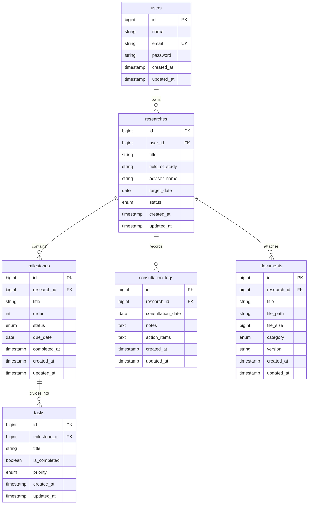

# Database

## Overview

Database menggunakan MariaDB 11.4 LTS. Karakter set `utf8mb4`, collation `utf8mb4_unicode_ci`.

> **Catatan implementasi:** skema final mengikuti **PRD §7** (`researches`, `chapters`, `tasks`, `supervision_logs`, `action_items`, `document_drafts`). Dokumen ini memakai penamaan alternatif (`milestones`, `consultation_logs`) dan disimpan sebagai referensi historis.

Tujuan: isolasi data per akun mahasiswa, pelacakan banyak riset per akun (*one-to-many*), pencatatan target mandiri, manajemen bab/tahapan (*milestones*), daftar tugas (*tasks*), log konsultasi/bimbingan mandiri, dan berkas draf.

Autentikasi API menggunakan Laravel Sanctum (`personal_access_tokens`).

---

## Schema

### 1. `users`
Menyimpan kredensial mahasiswa.

| Kolom | Tipe Data | Keterangan |
| :--- | :--- | :--- |
| `id` | `BIGINT UNSIGNED` | Primary Key, Auto Increment |
| `name` | `VARCHAR(255)` | Nama lengkap |
| `email` | `VARCHAR(255)` | Unique, email login |
| `password` | `VARCHAR(255)` | Hash Argon2id / Bcrypt |
| `remember_token` | `VARCHAR(100)` | Nullable |
| `created_at` | `TIMESTAMP` | Nullable |
| `updated_at` | `TIMESTAMP` | Nullable |

### 2. `researches`
Entitas skripsi/riset. Setiap user dapat memiliki lebih dari satu riset.

| Kolom | Tipe Data | Keterangan |
| :--- | :--- | :--- |
| `id` | `BIGINT UNSIGNED` | Primary Key, Auto Increment |
| `user_id` | `BIGINT UNSIGNED` | Foreign Key ke `users.id`, `ON DELETE CASCADE` |
| `title` | `VARCHAR(500)` | Judul skripsi/topik |
| `field_of_study` | `VARCHAR(255)` | Nullable, bidang kajian |
| `advisor_name` | `VARCHAR(255)` | Nullable, nama dosen pembimbing (catatan pribadi) |
| `target_date` | `DATE` | Nullable, tenggat target kelulusan mandiri |
| `status` | `ENUM` | Nilai: `draft`, `in_progress`, `completed`, `archived`. Default: `in_progress` |
| `created_at` | `TIMESTAMP` | Nullable |
| `updated_at` | `TIMESTAMP` | Nullable |

### 3. `milestones`
Tahapan terstruktur skripsi (contoh: Proposal, Bab 1-3, Seminar Proposal, Bab 4-5, Sidang Akhir).

| Kolom | Tipe Data | Keterangan |
| :--- | :--- | :--- |
| `id` | `BIGINT UNSIGNED` | Primary Key, Auto Increment |
| `research_id` | `BIGINT UNSIGNED` | Foreign Key ke `researches.id`, `ON DELETE CASCADE` |
| `title` | `VARCHAR(255)` | Nama tahap (misal: "Bab 1 Pendahuluan") |
| `order` | `INT UNSIGNED` | Urutan tampilan alur |
| `status` | `ENUM` | Nilai: `todo`, `in_progress`, `done`. Default: `todo` |
| `due_date` | `DATE` | Nullable, target selesai tahap |
| `completed_at` | `TIMESTAMP` | Nullable, waktu aktual selesai |
| `created_at` | `TIMESTAMP` | Nullable |
| `updated_at` | `TIMESTAMP` | Nullable |

### 4. `tasks`
Daftar checklist kerja harian pada milestone tertentu.

| Kolom | Tipe Data | Keterangan |
| :--- | :--- | :--- |
| `id` | `BIGINT UNSIGNED` | Primary Key, Auto Increment |
| `milestone_id` | `BIGINT UNSIGNED` | Foreign Key ke `milestones.id`, `ON DELETE CASCADE` |
| `title` | `VARCHAR(255)` | Deskripsi tugas |
| `is_completed` | `BOOLEAN` | Default: `false` |
| `priority` | `ENUM` | Nilai: `low`, `medium`, `high`. Default: `medium` |
| `created_at` | `TIMESTAMP` | Nullable |
| `updated_at` | `TIMESTAMP` | Nullable |

### 5. `consultation_logs`
Catatan mandiri hasil asistensi/bimbingan bersama dosen atau catatan progres personal.

| Kolom | Tipe Data | Keterangan |
| :--- | :--- | :--- |
| `id` | `BIGINT UNSIGNED` | Primary Key, Auto Increment |
| `research_id` | `BIGINT UNSIGNED` | Foreign Key ke `researches.id`, `ON DELETE CASCADE` |
| `consultation_date` | `DATE` | Tanggal bimbingan/pencatatan |
| `notes` | `TEXT` | Catatan revisi / hasil diskusi |
| `action_items` | `TEXT` | Nullable, daftar tindakan korektif |
| `created_at` | `TIMESTAMP` | Nullable |
| `updated_at` | `TIMESTAMP` | Nullable |

### 6. `documents`
Pelacakan berkas naskah, jurnal referensi, dan dataset pendukung.

| Kolom | Tipe Data | Keterangan |
| :--- | :--- | :--- |
| `id` | `BIGINT UNSIGNED` | Primary Key, Auto Increment |
| `research_id` | `BIGINT UNSIGNED` | Foreign Key ke `researches.id`, `ON DELETE CASCADE` |
| `title` | `VARCHAR(255)` | Nama berkas / judul referensi |
| `file_path` | `VARCHAR(500)` | Path storage lokal/S3 |
| `file_size` | `BIGINT UNSIGNED` | Ukuran file dalam bytes |
| `category` | `ENUM` | Nilai: `draft`, `reference`, `dataset`, `other`. Default: `draft` |
| `version` | `VARCHAR(50)` | Nullable, contoh: `v1.0`, `rev-2` |
| `created_at` | `TIMESTAMP` | Nullable |
| `updated_at` | `TIMESTAMP` | Nullable |

---

## Relationships (mermaid ER diagram)



---

## Migrations workflow

Urutan eksekusi migration file Laravel:

```text
database/migrations/
├── 2024_01_01_000000_create_users_table.php
├── 2024_01_01_000001_create_personal_access_tokens_table.php
├── 2024_01_01_000002_create_researches_table.php
├── 2024_01_01_000003_create_milestones_table.php
├── 2024_01_01_000004_create_tasks_table.php
├── 2024_01_01_000005_create_consultation_logs_table.php
└── 2024_01_01_000006_create_documents_table.php
```

### Panduan Eksekusi

Jalankan migrasi lingkungan lokal:
```bash
php artisan migrate
```

Reset total dan masukkan seed data demo:
```bash
php artisan migrate:fresh --seed
```

Deploy container produksi via Docker:
```bash
docker compose exec api php artisan migrate --force
```

Aturan migration:
- Dilarang memodifikasi migrasi lama yang telah merge ke branch `main`. Buat migration baru jika ada perubahan struktur schema: `php artisan make:migration alter_researches_add_column_x`.
- Foreign key wajib deklaratif menggunakan `$table->foreignId('...')->constrained()->cascadeOnDelete();`.

---

## Indexes & performance notes

### 1. Database Indexes
Semua foreign key otomatis terindeks oleh MySQL. Tambahan indeks manual untuk query filter:

```php
// researches table
$table->index(['user_id', 'status']); // Filter dashboard user

// milestones table
$table->index(['research_id', 'order']); // Urutan rendering bab

// tasks table
$table->index(['milestone_id', 'is_completed']); // Checklist query counter

// consultation_logs table
$table->index(['research_id', 'consultation_date']); // Timeline urut tanggal

// documents table
$table->index(['research_id', 'category']); // Filter berkas naskah/referensi
```

### 2. Constraints & Integrity
- Semua data turunan riset terikat dengan `ON DELETE CASCADE`. Menghapus 1 riset otomatis menghapus milestone, task, log, dan referensi dokumen secara tuntas via database engine.
- Penghapusan berkas fisik di storage ditangani via Eloquent Model Observers (`deleting` event) untuk mencegah orphaned files pada disk.

### 3. Query Optimization
- Hindari N+1 query pada controller: Selalu sertakan eager loading untuk relasi bertingkat.
  ```php
  Research::where('user_id', $userId)
      ->with(['milestones.tasks', 'documents'])
      ->get();
  ```
- Hindari `SELECT *`. Ekstrak kolom penting via parameter `$request->only()` / API Resource transformer.